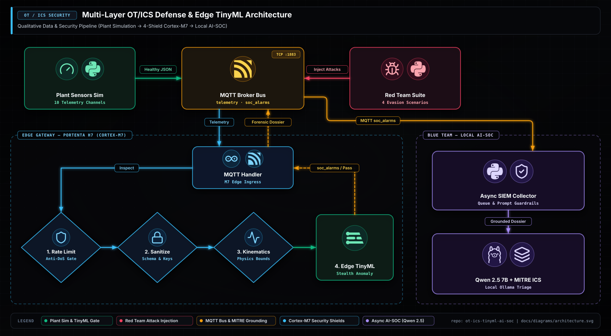

# Multi-Layer OT/ICS Security: Edge TinyML Anomaly Detection & AI-Assisted SIEM

A defense-in-depth Operational Technology (OT) security architecture combining **deterministic edge sanitization**, **TinyML thermodynamic anomaly detection** on an **Arduino Portenta H7 (ARM Cortex-M7 @ 480 MHz)**, and an **AI-assisted OT SOC/SIEM** powered by a local **Ollama (`Qwen 2.5`)** model constrained to the official **MITRE ATT&CK for ICS** matrix.

> Developed by **Giuseppe Ruggiero** and **Filomena Vigliotti** — *Software Security*, University of Naples Federico II (A.Y. 2025/2026).

---

## Architecture Overview



*[High-resolution PNG version](docs/diagrams/architecture.png)*

The system simulates a centrifugal hydraulic industrial pump monitored over MQTT and protected by four sequential security shields at the Edge Gateway before alerts ever reach the AI SOC:

1. **Physical Simulation & Dataset Pipeline (`simulator/`):** Models 10 coupled thermodynamic and fluid-dynamic sensors using pump affinity laws, day/night work shifts, ambient thermal cycles, and progressive mechanical wear.
2. **Hardened Edge Gateway (`firmware/M7/M7.ino`):**
   - **Shield 1 — Time-Window Rate Limiting (Anti-DoS):** Enforces a sliding window of `4 packets / 1000 ms` with automatic `5000 ms` attack recovery and single-alert emission during sustained flooding.
   - **Shield 2 — Bounded Ingress & Input Sanitization:** Rejects oversized MQTT frames (`> 1536` bytes), verifies `50–1024` byte payload lengths, checks `ArduinoJson` deserialization + overflow flags, enforces strict types across all 10 float channels, blocks `NaN`/`Infinity`, and sanitizes `timestamp` length (`<= 30`) and control characters (`\n`, `\r`, `<`, `{`, `"`).
   - **Shield 3 — Physical Bounds & Kinematic Guardrails:** Validates industrial operating ranges per sensor and detects physically impossible instantaneous jumps (`|ΔP| > 6.0 bar` on discharge pressure, `|ΔRPM| > 1000.0` on pump speed).
   - **Shield 4 — Semantic TinyML Inference (Edge Impulse):** Evaluates the 10-sensor vector on-device to catch stealth multivariate thermodynamic inconsistencies (`anomaly > 0.5`) that remain within single-sensor bounds and Rate-of-Change limits.
3. **AI-Assisted OT SIEM (`siem/`):** Subscribes to forensic JSON dossiers emitted by the Portenta H7, queues analysis asynchronously to keep the MQTT keepalive responsive, binds the local `Qwen 2.5` prompt to the authoritative `mitre_ics_matrix.xlsx` catalog (80 techniques, ATT&CK for ICS v19), wraps untrusted dossiers inside `<UNTRUSTED_TELEMETRY_DOSSIER>` delimiters, and appends triage reports plus OT containment playbooks to a log file.

---

## Monitored Telemetry Channels

| ID | Telemetry Field | Physical Quantity | Allowed Edge Bounds |
| :--- | :--- | :--- | :--- |
| `S1` | `S1_Pompa_RPM` | Pump rotational speed (RPM) | `0.0 – 3500.0` (`|Δ| <= 1000.0`) |
| `S2` | `S2_Corrente_A` | Motor electrical current (A) | `0.0 – 50.0` |
| `S3` | `S3_Pres_Aspirazione_bar` | Suction pressure (bar) | `-1.0 – 10.0` |
| `S4` | `S4_Pres_Mandata_bar` | Discharge pressure (bar) | `-1.0 – 25.0` (`|Δ| <= 6.0`) |
| `S5` | `S5_Portata_Lmin` | Volumetric flow rate (L/min) | `0.0 – 1000.0` |
| `S6` | `S6_Temp_Fluido_C` | Process fluid temperature (°C) | `-20.0 – 150.0` |
| `S7` | `S7_Vib_Cuscinetto_Ant_mms` | Front bearing vibration (mm/s) | `0.0 – 50.0` |
| `S8` | `S8_Vib_Cuscinetto_Post_mms` | Rear bearing vibration (mm/s) | `0.0 – 50.0` |
| `S9` | `S9_Temp_Motore_C` | Motor winding temperature (°C) | `-20.0 – 150.0` |
| `S10` | `S10_Efficienza_Pct` | Hydraulic pump efficiency (%) | `0.0 – 100.0` |

---

## Threat Model (STRIDE) & Red Team Scenarios

The architecture was evaluated using **STRIDE** threat modeling against four progressively stealthier OT attack scripts in [`attacks/`](attacks/):

| Scenario | Script | Attack Technique & STRIDE Focus | Mitigating Layer |
| :--- | :--- | :--- | :--- |
| **1 — DoS / Replay** | [`attacks/1_2_DoS_MitM.py`](attacks/1_2_DoS_MitM.py) | Passive MQTT sniffing followed by volumetric packet replay (`Denial of Service`) | Edge Shield 1 (rate limiter) + SIEM correlation (`T0814`) |
| **2 — Structural Fuzzing** | [`attacks/2_Structural_exploit.py`](attacks/2_Structural_exploit.py) | Oversized payloads, missing keys, `\n` log injection, float/string type confusion, extreme physical out-of-bounds values (`Tampering`) | Edge Shield 2 & Shield 3 + SIEM dossier inspection |
| **3 — Semantic Spoofing** | [`attacks/3_Semantic_spoofing.py`](attacks/3_Semantic_spoofing.py) | Slow discharge-pressure ramp (`<= 6.0 bar/step`) paired with contradictory current (`2.5 A` @ `2900 RPM`) and motor heat (`74 °C`) (`Spoofing / Tampering`) | Edge Shield 4 (TinyML anomaly engine) |
| **4 — Indirect Prompt Injection** | [`attacks/4_Prompt_injection.py`](attacks/4_Prompt_injection.py) | System-override instructions injected in `timestamp` targeting the downstream LLM SOC (`Elevation / Integrity`) | Edge Shield 2 (`<`, `{`, `\n`, `\r`, `"`, len `> 30`) + SIEM `<UNTRUSTED_TELEMETRY_DOSSIER>` isolation & CR/LF log escaping |

### Static Application Security Testing (SAST)
- **Firmware C++ (`firmware/M7/M7.ino`):** Audited with **Flawfinder** (0 vulnerabilities reported over ~225 LOC) and **Cppcheck** (0 memory leaks or buffer overflows; fixed `abs()` -> `fabsf()`, strict JSON overflow checks, bounded ingress buffer, non-blocking MQTT reconnect backoff, and externalized credentials).
- **Python Pipeline (`simulator/`, `attacks/`, `siem/`):** Audited with **Bandit** (resolved `B113` missing request timeout by adding configurable `OLLAMA_TIMEOUT_S` via `requests.Session`, eliminated bare `except:` clauses, fixed duplicate JSON keys, deduplicated shared hydraulic physics into `simulator/pump_physics.py`, and decoupled blocking LLM HTTP calls from the MQTT network thread).

---

## Repository Structure

```text
ot-ics-tinyml-ai-soc/
├── .env.example                     # Environment variable template for MQTT & Ollama
├── .gitignore                       # Excludes .env, arduino_secrets.h, outputs, logs
├── requirements.txt                 # Python dependencies (paho-mqtt, pandas, openpyxl, tabulate, requests)
├── common/
│   ├── __init__.py
│   └── mqtt_config.py               # .env loader & paho-mqtt 1.x/2.x client factory
├── docs/
│   └── diagrams/                    # Dark-theme vector SVG & high-DPI PNG architecture diagrams
├── firmware/
│   └── M7/
│       ├── arduino_secrets.h.example # Wi-Fi / MQTT header template (copy to arduino_secrets.h)
│       └── M7.ino                   # Arduino Portenta H7 M7 4-shield gateway + TinyML firmware
├── simulator/
│   ├── __init__.py
│   ├── pump_physics.py              # Shared thermodynamic/fluid-dynamic 10-sensor pump model
│   ├── sensor_simulator.py          # Offline historical telemetry generator (40,000 JSON samples)
│   ├── json_to_csv.py               # Splits JSON into 1,440-sample daily CSVs for Edge Impulse
│   └── simulator_mqtt_blue.py       # Live Blue Team healthy MQTT telemetry stream
├── siem/
│   ├── mitre_ics_matrix.xlsx        # Authoritative MITRE ATT&CK for ICS (v19, 80 techniques)
│   └── siem_mitre_qwen.py           # Queued Ollama (Qwen 2.5) OT SIEM correlator & logger
└── attacks/
    ├── 1_2_DoS_MitM.py              # Scenario 1: Sniffing + volumetric replay flood
    ├── 2_Structural_exploit.py      # Scenario 2: Schema, type, bounds, and newline fuzzing
    ├── 3_Semantic_spoofing.py       # Scenario 3: Thermodynamic spoofing below RoC threshold
    └── 4_Prompt_injection.py        # Scenario 4: LLM prompt-injection Trojan telemetry
```

---

## Setup & Usage

### 1. Python Environment Configuration
```bash
python -m venv .venv
# Linux/macOS: source .venv/bin/activate
# Windows PowerShell: .venv\Scripts\Activate.ps1
pip install -r requirements.txt

cp .env.example .env
# Edit .env to configure your MQTT broker, topics, and Ollama endpoint/model
```

> **Security note:** Use a private local Mosquitto broker (or TLS-authenticated broker) for sensitive environments instead of the default public test broker.

### 2. Local LLM Setup (Ollama)
Install [Ollama](https://ollama.com/) and pull the model used by the SIEM:
```bash
ollama pull qwen2.5
ollama serve
```

### 3. Arduino Portenta H7 Firmware
1. Copy [`firmware/M7/arduino_secrets.h.example`](firmware/M7/arduino_secrets.h.example) to `firmware/M7/arduino_secrets.h` (git-ignored) and set your Wi-Fi credentials and MQTT settings.
2. Generate historical training CSVs (optional, to retrain your Edge Impulse model):
   ```bash
   python simulator/sensor_simulator.py --samples 40000 --interval-s 60
   python simulator/json_to_csv.py
   ```
3. Import your Edge Impulse Arduino library (`Industrial_Pump_Security_inferencing.h`) along with `PubSubClient` and `ArduinoJson` into the Arduino IDE, then flash `firmware/M7/M7.ino` onto the Portenta H7 M7 core.

### 4. Running the End-to-End Simulation
Open separate terminals from the repository root:

```bash
# Terminal 1: Start the AI-assisted OT SIEM
python siem/siem_mitre_qwen.py

# Terminal 2: Start nominal Blue Team pump telemetry
python simulator/simulator_mqtt_blue.py --interval 2.0

# Terminal 3: Launch one Red Team attack scenario
python attacks/1_2_DoS_MitM.py --max-packets 200
# or: python attacks/2_Structural_exploit.py
# or: python attacks/3_Semantic_spoofing.py
# or: python attacks/4_Prompt_injection.py
```

All CLI scripts support `--help`, `--broker`, `--port`, and `--topic` flags to override `.env` defaults without editing source code.

---

## Disclaimer

This codebase was built for **academic research and defensive security testing** in an isolated lab/simulation setup. Do not point the attack scripts at production industrial networks or third-party infrastructure without explicit authorization.

